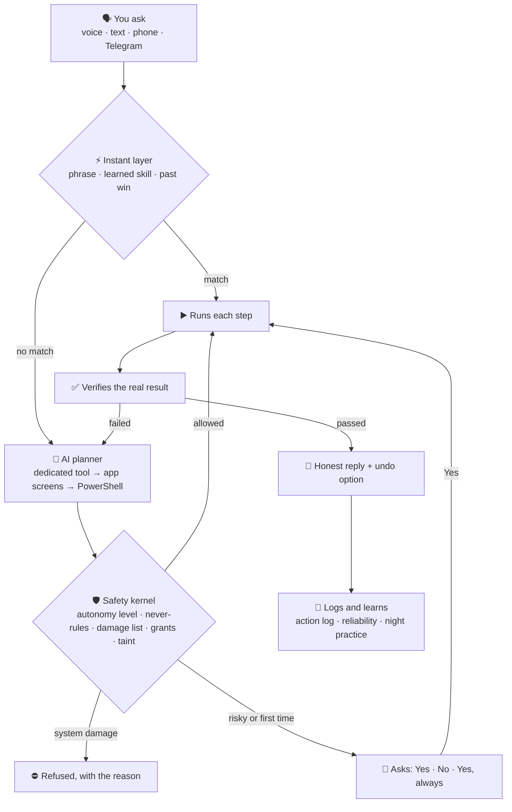

<div align="center">

# 🧡 Chutku

### Your voice assistant for Windows. Say it, and she does it.

**English · Hindi · Hinglish** &nbsp;•&nbsp; **Voice or text** &nbsp;•&nbsp; **Free** &nbsp;•&nbsp; **Your data stays on your PC**


*Designed and developed by **Siddhant Vashisth***

[⬇️ Download](https://github.com/sidvashisth2005/Chutku-releases/releases/latest) &nbsp;·&nbsp; [📖 How to install](https://github.com/sidvashisth2005/Chutku-releases#install-in-6-easy-steps)

</div>

---

## 📑 Contents
1. [⭐ What makes Chutku special](#-what-makes-chutku-special)
2. [🧰 Everything else Chutku can do](#-everything-else-chutku-can-do)
3. [⚙️ How it works](#️-how-it-works)
4. [🛡️ Safety and privacy](#️-safety-and-privacy)
5. [📦 Install, updates and uninstall](#-install-updates-and-uninstall)
6. [💬 Try saying](#-try-saying)

---

## ⭐ What makes Chutku special

| | Feature | What it means for you |
|:-:|---|---|
| 🎯 | **Does almost anything, refuses only damage** | Opens apps, files, settings, installs and much more. She only refuses what could break Windows (system files, boot, Defender or firewall off, formatting a drive), and tells you why. She asks once before risky steps; **"Yes, always"** means she never asks again for that exact thing. |
| ✅ | **Verified results, never a fake "done"** | Every step is checked after it runs: the file is really written, the window really opens, the setting really changed. You see *"Verified: 3 of 3 steps"*, and failures are admitted honestly. |
| 🌙 | **Learns by herself every night** | While the PC is idle on charger, she practises a 1,458-item task bank and replays your real requests. She gives her mistakes to the AI, keeps only verified fixes, and turns repeats into instant skills. A hidden test set makes sure she really learns instead of memorising. |
| ⚡ | **Instant answers** | About 190 everyday requests (time, volume, open an app, disk space…) answer in **milliseconds**, without the AI. Learned skills add more over time. |
| 📱 | **Full phone control, from anywhere** | Live screen at about 30 fps plus laptop sound, trackpad and gestures, pinch zoom, keyboard. **Smart tap** snaps to buttons; voice clicks ("click Save"); window switcher, read-aloud, files, chat and approvals. **Watch mode** for video. It uses your private Tailscale network, has a PIN, and works on mobile data. |
| 🔓 | **Reach the laptop even after a restart** | Telegram tells you *"Laptop is ON"*, with a link that shows the Windows lock screen on your phone, so you can sign in remotely. It works only on the lock screen, never on your desktop. |
| ✈️ | **Telegram remote** | Send tasks by text or voice note, and approve with buttons. **Handoff mode** ("main bahar ja raha hoon") sends your results to Telegram for 4 hours. Pairing is by QR; strangers are ignored. |
| 🛠️ | **System control with undo** | Install and uninstall apps (machine-wide installs use Windows' own "Yes" prompt). Windows settings, your registry values, startup apps, services. Every change is journaled; *"wo setting wapas karo"* puts it back. |
| ⏪ | **Undo everything** | Deleted files go to the Recycle Bin, and file changes are journaled. **Causal Rewind** (*"pichhle 10 minute ka sab wapas karo"*) undoes a whole stretch of work. |
| 🧠 | **Memory and mind map** | She remembers people, facts, lists, habits and topics, shown as a clickable **mind map** that you can edit or clear. "Know me" learns what you watch, open and visit, all locally. |
| 🧸 | **Toddler-easy app** | A guided setup that checks your AI key live (**Gemini first**, Groq as the alternative) and ends with a celebration. Simple menu, **"What can I say?"** page with tap-to-try examples, everyday tips, and errors that say what to do next. |
| 🎨 | **Tiranga design** | Saffron, chakra blue and mint, in light and dark, following your Windows theme. |
| 🎙️ | **Owner Voice Lock** | After a one-time enrollment, only **your** voice can give tasks; others can only ask questions. |

---

## 🧰 Everything else Chutku can do

<details open>
<summary><b>🪟 Apps and windows</b></summary>

- Open, close and switch apps; snap and arrange windows
- Built-in actions for **Spotify, VLC, WhatsApp, Telegram, Brave/YouTube, VS Code, Discord, Settings, File Explorer, Notepad**
- *"How do I … in X?"* answered from her notes on that app
- Works in the background, without moving your mouse
- **Teach by showing** (*"sikho …"*): show her a task once, and she repeats it
</details>

<details open>
<summary><b>📁 Files and documents</b></summary>

- Find any file by name; newest, biggest or recent files; *"meri last PDF kholo"*
- Tidy Downloads, Desktop or Documents (undoable)
- Create, read, write, zip and unzip
- Read text from PDFs and documents, plus OCR on screenshots
- A drive index for fast search
</details>

<details open>
<summary><b>👀 Screen understanding</b></summary>

- *"What's on my screen?"*, then read or click what's visible
- A survey of open windows, and screenshots
</details>

<details open>
<summary><b>🌐 Web</b></summary>

- Search Google, YouTube, Wikipedia, GitHub, Amazon and Flipkart; play YouTube
- Weather, news and stock quotes; read web pages
- A **signed-in browser** for sites that need your login
- **Research tasks** run in the background and cite their sources
</details>

<details open>
<summary><b>🎵 Media and system</b></summary>

- Play, pause, next track and playlists; volume and brightness; switch audio output
- Battery, disk and performance; **free up space**; lock the PC; power (asks first)
</details>

<details open>
<summary><b>💬 Messages and email</b></summary>

- WhatsApp and Telegram messages (she always asks before writing to someone new)
- Read the last message; draft-first email
</details>

<details open>
<summary><b>⏰ Planning and automation</b></summary>

- Reminders and scheduled or repeating tasks (*"har roz 8 baje …"*)
- Morning briefing
- **Routines**: one phrase runs several steps; personal shortcuts
- Blueprints: news digest, weekly backup, insights, Downloads tidy, research watch
- **Board**: your to-dos plus Chutku's background research
- **Busy mode**: *"aur haan …"* adds to the running task, *"baad mein karna"* queues the next one, and side questions are answered without stopping
</details>

<details open>
<summary><b>🩺 Self-care and growth</b></summary>

- *"Apna checkup karo"* / *"khud ko theek karo"*: a health check and self-repair
- Health alerts and backups (*"backup bana lo"*)
- **Evolve**: Chutku proposes improvements to herself, and you approve them
</details>

<details open>
<summary><b>👩‍💻 For coders</b></summary>

- Run Python scripts and PowerShell commands (she asks first)
- A project builder for small apps and websites
</details>

<details open>
<summary><b>🚪 Ways to open and talk to Chutku</b></summary>

- Start menu or desktop app · **`chutku.localhost`** in any browser · system tray
- The **floating orb**, with lip-sync and moods
- **Ctrl + Alt + Space** from any app · the wake phrase **"Oye Chutku"**
</details>

<details open>
<summary><b>🧩 Brain and voice</b></summary>

- **Cloud brain:** Gemini or Groq (free keys), with automatic fallback between them
- **Offline packs:** local brain, voice and screen models
- Choose per request: *"local se karo …"* / *"gemini se pucho …"*
- Whisper speech-to-text, Kokoro natural voice, Gemini Live conversation, mic mute
</details>

---

## ⚙️ How it works



| Step | What happens |
|:-:|---|
| **1** | **You ask:** by hotkey, wake phrase, phone, Telegram or by typing. |
| **2** | **Instant layer:** a known phrase, a learned skill or a past success → done in milliseconds. |
| **3** | **Planning:** the AI planner proposes steps, using your past wins as examples. It tries a dedicated tool first, then the app's own screens, then PowerShell. |
| **4** | **Safety check, on every step:** your autonomy level (*Safe · Edits · Full*), never-rules, the system-damage list, folder grants. Text from web pages or messages can **never** give orders. |
| **5** | **Asks only when needed:** deletes, risky steps, new recipients, admin tasks. |
| **6** | **Runs and verifies:** each step's result is checked; failures are re-planned and remembered. |
| **7** | **Honest reply:** what really happened, plus how to undo it. |
| **8** | **Learns:** a tamper-evident log and a reliability ledger (steps that keep failing start asking), plus nightly practice. |

---

## 🛡️ Safety and privacy

> [!IMPORTANT]
> Chutku **never runs as administrator**. Tasks that need admin go through Windows' own **"Yes"** prompt.

- 🛑 **Ctrl + Alt + F12** stops everything at once; **Pause actions** at any time; an independent guard; clean restarts
- 🔒 Your data stays on your PC. Keys live in **Windows Credential Manager**; only your request goes to the AI service
- 📱 The phone and Telegram use PINs, single-use approval buttons and your private network. Risky steps can only be approved at the laptop
- ♻️ Deleted files go to the **Recycle Bin**, so you can bring them back

---

## 📦 Install, updates and uninstall

| | |
|---|---|
| ⬇️ **Install** | One file, **`Chutku-Setup-for-Windows.exe`**. No admin needed; the setup checks itself. The program's code is compiled and hidden. |
| 🔄 **Updates** | A small popup appears; click **Update now**. Your data is kept. |
| 🗑️ **Uninstall** | Start menu → **Uninstall Chutku** (or Settings → Apps). |
| 💻 **Needs** | Windows 10 or 11, 64-bit, about 1 GB free, and a microphone for voice. |

---

## 💬 Try saying

```text
Spotify pe lofi chalao              meri last PDF kholo
Downloads saaf karo                 install VLC
file extensions dikhao              kitni jagah bachi hai
remind me in 20 minutes to drink water
good morning                        what's on my screen?
research karke batao best free PDF editor
main bahar ja raha hoon, phone pe batana
```

---

<div align="center">

**Made with 🧡 in India by Siddhant Vashisth**

*Chutku (छुटकू): small name, big help.*

</div>
