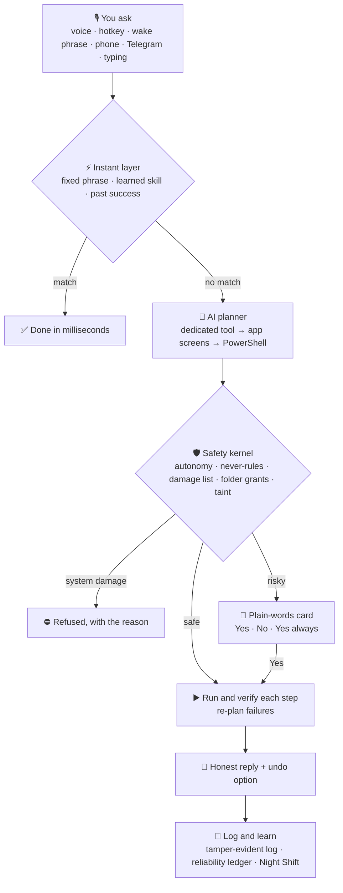

<div align="center">

# 🪔 Chutku

### Your PC assistant that does almost anything, checks its own work and learns every night

**English · हिन्दी · Hinglish** — by voice or by text


*"Spotify kholo aur volume 40 karo." · "Meri resume file dhundo." · "Wo setting wapas karo."*

</div>

---

## 📑 Contents

| | | |
|:--|:--|:--|
| ⭐ [Main features](#main) | 🧰 [Everything else](#everything) | ⚙️ [How it works](#how) |
| 🛡️ [Safety and privacy](#safety) | 📦 [Install and updates](#install) | 💬 [Try saying](#try) |

---

<a id="main"></a>

## ⭐ Main features and innovations

### 1. 🧠 Does almost anything, refuses only damage

> Ask in **English, Hindi, Hinglish or Devanagari**, by voice or text. Chutku plans the steps, does them and **checks every result**.

- ❌ **Refuses only** what could break Windows (system files, boot, turning off Defender or the firewall, formatting a drive), and it always says why.
- ✋ **Asks once** before risky steps.
- ✅ **"Yes, always"** means it never asks again for that exact thing.

### 2. ✔️ Verified results, never a fake "done"

Every action is checked after it runs: the file is really written, the app window is really open, the setting reads back correctly.

```text
✓ Verified: 3 of 3 steps
```

And when something fails, Chutku says so honestly.

### 3. 🌙 Learns by itself every night: Night Shift and rewarded practice

While the PC is idle and charging, Chutku goes to school:

| Step | What happens |
|:--:|:--|
| 🔁 | Replays your real requests and practises a **1,458-item task bank** |
| 🤖 | Gives its misses to the AI and **keeps only verified answers** |
| ⚡ | Turns repeated successes into instant **learned skills** |
| 📚 | Collects **fine-tune data** |
| 🎯 | Checks itself on **held-out tests**, so it really learns instead of memorising |

### 4. ⚡ Instant answers

About **190 everyday phrasings** (time, volume, opening apps, disk space and more) are answered **in milliseconds, without the AI model**. Learned skills add more over time.

### 5. 📱 Full phone control from anywhere

Through your private **Tailscale** network:

<table>
<tr>
<td width="50%" valign="top">

**👀 See and hear**
- Live screen at **~30 fps** (H.264)
- The laptop's own sound
- **Watch mode:** full-screen video and sound only
- Landscape layout

</td>
<td width="50%" valign="top">

**👆 Control**
- Trackpad, gestures, pinch zoom, keyboard
- **Smart tap** and a **magnetic pointer** that snap to buttons
- Voice clicks: *"click Save"*
- Window switcher, read-aloud, files, chat and approvals

</td>
</tr>
</table>

🔒 PIN-protected · 📶 works over mobile data

### 6. 🔌 Reach the laptop even after a restart

Telegram tells you **"Laptop is ON"**, with a link that shows the **Windows lock screen on your phone**. Type your password and sign in remotely.
The helper works **only on the lock screen**, never on your desktop.

### 7. ✈️ Telegram as a second remote

- Send tasks by **text or voice note**.
- **Approve or reject** with buttons.
- **Handoff mode:** *"main bahar ja raha hoon"* sends results to Telegram for 4 hours.
- **QR-code pairing:** strangers are ignored.

### 8. 🛠️ System control with undo

| Area | What Chutku can do |
|:--|:--|
| 📦 **Apps** | Install and uninstall through **winget**. Machine-wide installs use the Windows "Yes" prompt |
| ⚙️ **Settings** | File extensions, hidden files, taskbar, notifications, power plan |
| 🗝️ **Registry** | Your own (per-user) registry values |
| 🚀 **Startup and services** | List them, and switch them on or off |
| ↩️ **Undo** | Every system change is journaled: *"wo setting wapas karo"* restores it |

### 9. ↩️ Undo everything

- 🗑️ Deleted files go to the **Recycle Bin**.
- 📝 File changes are **journaled**.
- ⏪ **Causal Rewind:** *"pichhle 10 minute ka sab wapas karo"* undoes a whole stretch of work.

### 10. 🧩 Personal memory and mind map

Chutku remembers **people, facts, lists, habits and recent topics**, and shows them as a **clickable mind map**. You can edit or forget anything.
**"Know me"** builds a local profile of what you watch, open and visit.

### 11. 🧸 Toddler-easy app

| | |
|:--|:--|
| 🚀 **Setup** | A required guided setup that checks your AI key live (**Gemini** first, **Groq** second) and ends with a celebration 🎉 |
| 🏠 **Daily use** | A **Simple menu**, a **"What can I say?"** page with tap-to-try examples, first-week tips, and an error that always says what to do next |
| 🎨 **Look** | The **Tiranga design** (🟠 saffron · 🔵 chakra blue · 🟢 mint) in light and dark |

### 12. 🎙️ Owner Voice Lock

After a one-time enrollment, **only your voice can give tasks**. Other voices can only ask questions.

---

<a id="everything"></a>

## 🧰 Everything else Chutku can do

<details open>
<summary><b>🪟 Apps and windows</b></summary>

- Open, close and switch apps; snap and arrange windows.
- App actions for **Spotify, VLC, WhatsApp, Telegram, Brave/YouTube, VS Code, Discord, Settings, File Explorer** and **Notepad**.
- *"How do I … in X"* answers from per-app notes.
- Background control without moving your mouse.
- **Teach by showing** (*"sikho …"*) for new app routines.

</details>

<details>
<summary><b>📁 Files and documents</b></summary>

- Search by name; newest, biggest and recent files; open the last PDF or photo.
- Tidy Downloads, Desktop or Documents (undoable).
- Create, read, write, zip and unzip.
- Read text from PDFs and documents; OCR on screenshots.
- A drive index for fast search.

</details>

<details>
<summary><b>🖥️ Screen understanding</b></summary>

- *"What's on my screen"*; read or click what's visible.
- A screen survey of open windows, and screenshots.

</details>

<details>
<summary><b>🌐 Web</b></summary>

- Search **Google, YouTube, Wikipedia, GitHub, Amazon** and **Flipkart**; play YouTube.
- Weather, news and stock quotes; read web pages.
- A signed-in browser for sites that need your login.
- Background research tasks that **cite their sources**.

</details>

<details>
<summary><b>🎵 Media and system</b></summary>

- Play, pause, next track and playlists; volume and brightness; switch the audio output device.
- Battery, disk and performance; free up space.
- Lock the PC; power actions with a confirmation.

</details>

<details>
<summary><b>💬 Messages and email</b></summary>

- **WhatsApp** and **Telegram** messages (always asks before a new recipient).
- Read the last message; draft-first email.

</details>

<details>
<summary><b>⏰ Time and planning</b></summary>

- Reminders; scheduled and repeating tasks (*"har roz 8 baje …"*); the morning briefing.
- **Routines:** one phrase runs several steps. Personal shortcuts.
- **Automation blueprints:** news digest, weekly backup, insights, Downloads tidy, research watch.
- **Board:** your to-dos plus Chutku's background research tasks.

</details>

<details>
<summary><b>🏃 Busy mode</b></summary>

While a task runs:
- *"aur haan …"* adds to it;
- *"baad mein karna"* queues the next one;
- side questions are answered without stopping the task.

</details>

<details>
<summary><b>🩺 Self-care</b></summary>

- *"apna checkup karo"* or *"khud ko theek karo"* runs the doctor and repairs.
- Health alerts; backups (*"backup bana lo"*).
- **Evolve:** Chutku proposes improvements to itself, which you approve.

</details>

<details>
<summary><b>👩‍💻 Code helpers</b></summary>

- Run **Python** scripts and **PowerShell** commands (asks first).
- A project builder for small apps and sites.

</details>

<details>
<summary><b>🚪 Ways to open Chutku</b></summary>

- The Start menu or the desktop app.
- `chutku.localhost` in any browser.
- The **floating orb**, with lip-sync and moods.
- The system tray.
- <kbd>Ctrl</kbd> + <kbd>Alt</kbd> + <kbd>Space</kbd>, or *"Oye Chutku"*.

</details>

<details>
<summary><b>🧠 Brain and voice</b></summary>

| Brain | Voice |
|:--|:--|
| ☁️ Cloud brain: **Gemini** or **Groq** (free keys, automatic fallback between them) | 🎧 **Whisper** speech-to-text |
| 💻 Offline packs for a local brain, voice and screen models | 🗣️ **Kokoro** natural voice |
| 🎛️ Per-request choice: *"local se karo …"* / *"gemini se pucho …"* | 🔴 **Gemini Live** conversation, the wake phrase and mic mute |

</details>

---

<a id="how"></a>

## ⚙️ How it works



| # | Stage | What happens |
|:--:|:--|:--|
| 1 | 🎙️ **Ask** | By voice (hotkey, wake phrase, phone or Telegram) or by typing |
| 2 | ⚡ **Instant layer** | A fixed phrase, a learned skill or a past success is answered or done immediately |
| 3 | 🧠 **Plan** | The AI planner proposes steps, using similar past wins as examples. It tries a dedicated tool first, then the app's own screens (UI automation or browser), then PowerShell |
| 4 | 🛡️ **Safety kernel** | Your autonomy level (Safe / Edits / Full), never-rules, the system-damage list, folder grants, and taint: text from web pages or messages can never give orders |
| 5 | 🙋 **Ask only when needed** | Deletes, risky steps, new recipients and admin tasks get a plain-words card: **Yes**, **No** or **Yes always** |
| 6 | ▶️ **Run and verify** | Each step is checked, failures are re-planned, and Chutku remembers what went wrong |
| 7 | 💬 **Reply honestly** | What really happened, plus the undo option |
| 8 | 📒 **Log and learn** | A tamper-evident action log, an Activity view with traces, the reliability ledger (steps that keep failing start asking), and nightly learning |

---

<a id="safety"></a>

## 🛡️ Safety and privacy

<table>
<tr>
<td width="50%" valign="top">

### 🔐 Control
- **Never runs as administrator.** Admin tasks go through Windows' own "Yes" prompt.
- 🛑 **Emergency stop:** <kbd>Ctrl</kbd> + <kbd>Alt</kbd> + <kbd>F12</kbd>, plus **Pause actions**.
- An **independent guard** and a **clean restart**.

</td>
<td width="50%" valign="top">

### 🏠 Privacy
- **Your data stays on your PC.**
- 🔑 Keys live in **Windows Credential Manager**.
- Only your request goes to the AI service.
- 📱 Phone and Telegram use PINs, single-use approval buttons, a tailnet-only connection, and laptop-only rules for risky steps.

</td>
</tr>
</table>

---

<a id="install"></a>

## 📦 Install, updates and uninstall

| | |
|:--:|:--|
| 💿 | One **`Chutku-Setup-for-Windows.exe`**: no admin needed, checks itself, with compiled and hidden code |
| 🔄 | An in-app **"Update now"** popup that keeps your data |
| 🗑️ | **"Uninstall Chutku"** in the Start menu |
| 🏗️ | Releases are built and published from the owner's laptop |

---

<a id="try"></a>

## 💬 Try saying

| 🇬🇧 English | 🇮🇳 Hinglish | 🪔 हिन्दी |
|:--|:--|:--|
| open Spotify | Spotify kholo | स्पॉटिफाई खोलो |
| set volume to 40 | volume 40 karo | आवाज़ 40 करो |
| find my resume | meri resume file dhundo | — |
| install VLC | VLC install karo | — |
| remind me in 10 minutes to drink water | 10 min baad pani peena yaad dilana | — |
| undo the last 10 minutes | pichhle 10 minute ka sab wapas karo | — |

> 💡 The **"What can I say?"** page in the app has many more examples you can tap to try.

---

<div align="center">

**Chutku v1.2.3**

Designed and developed by **Siddhant Vashisth** 🇮🇳

</div>
